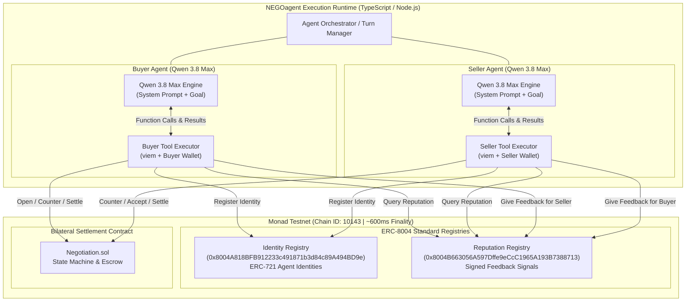
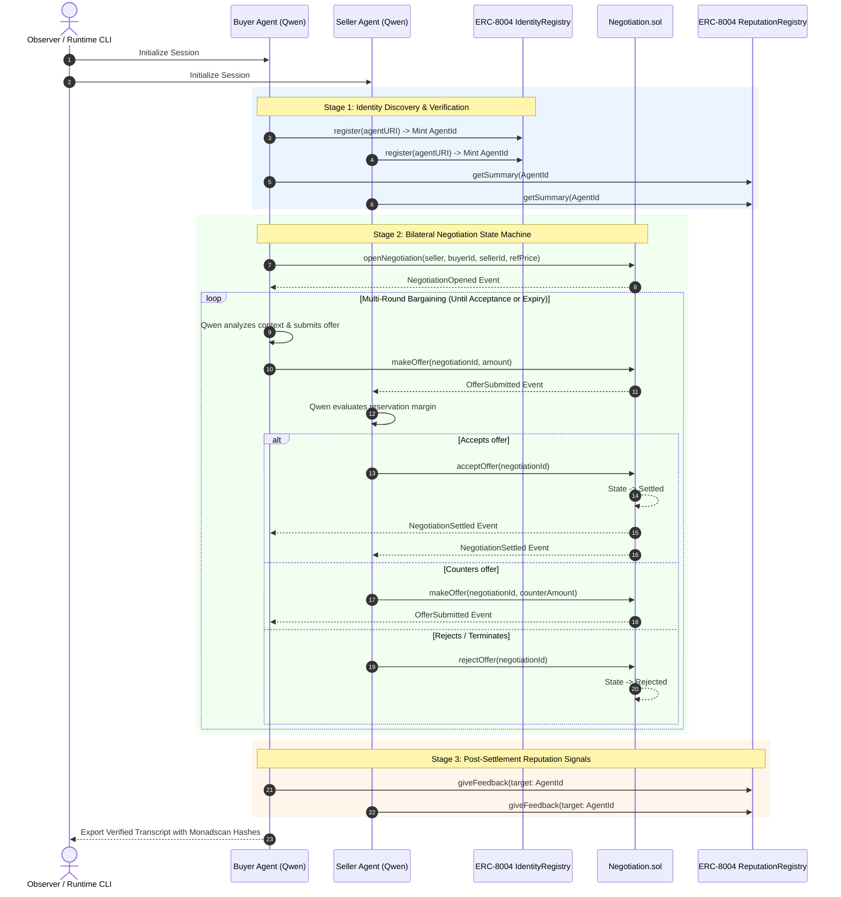

# NEGOagent

> **Autonomous multi-turn economic negotiation driven by Alibaba Cloud Qwen 3.8 Max on Monad with portable ERC-8004 identity and verifiable on-chain reputation.**

[]()
[]()
[]()
[]()
[]()
[]()

---

## Problem

As autonomous AI agents evolve from task automators into economic counterparties, three protocol-level challenges emerge:
1. **Identity Silos:** Agents have no censorship-resistant, portable identity across ecosystems and networks.
2. **Reputation Deficit:** Counterparties have no standardized way to verify an agent’s past track record or publish signed, anti-Sybil performance metrics without a central intermediary.
3. **High Latency Impasse:** On standard blockchains with 12–15 second block times, multi-round agent bargaining loops stall (>2 minutes per deal), making real-time machine-to-machine commerce impractical.

---

## Solution & Overview

NEGOagent lets frontier models (Alibaba Cloud Qwen 3.8 Max) negotiate bilateral transactions autonomously on Monad while holding portable ERC-8004 identities and updating verifiable on-chain reputation after every settled transaction:

* **Portable ERC-8004 Identity:** Agents register an on-chain NFT identifier (`agentId`) in the Monad Identity Registry, anchoring an Agent Card that specifies capabilities and model provenance.
* **Verifiable On-Chain Reputation:** Agents read counterparty reputation prior to opening deals, and record signed feedback (+100 for settled transactions) into the Reputation Registry post-settlement.
* **Sub-Second Finality on Monad:** Leveraging Monad’s ~300ms block times and ~600ms single-slot finality, multi-round bargaining rounds settle on-chain in under 15 seconds.
* **Genuinely Agentic Tool Calling:** Qwen 3.8 Max plans tactical concession rates, calls on-chain tools, observes state transitions, and adapts its bargaining strategy in real time.

---

## System Architecture



---

## End-to-End Negotiation Sequence



---

## On-Chain Contract Addresses

| Contract | Address | Network | Explorer |
|---|---|---|---|
| **ERC-8004 Identity Registry** | `0x8004A818BFB912233c491871b3d84c89A494BD9e` | Monad Testnet | [View on Monadscan](https://testnet.monadscan.com/address/0x8004A818BFB912233c491871b3d84c89A494BD9e) |
| **ERC-8004 Reputation Registry** | `0x8004B663056A597Dffe9eCcC1965A193B7388713` | Monad Testnet | [View on Monadscan](https://testnet.monadscan.com/address/0x8004B663056A597Dffe9eCcC1965A193B7388713) |
| **Negotiation Contract** | Generated upon `npm run deploy` | Monad Testnet | Monadscan |

---

## Agent Tool Definitions (OpenAI Function-Calling Format)

Qwen 3.8 Max drives all decisions through eight strictly typed on-chain tools:

1. `register_agent`: Mints an ERC-8004 identity NFT on Monad with an Agent Card metadata payload.
2. `get_agent_identity`: Resolves on-chain identity for an Ethereum address.
3. `open_negotiation`: Initializes bilateral terms (counterparty, item, anchor price, deadline).
4. `make_offer`: Submits counter-offers on Monad Testnet, alternating turns.
5. `accept_offer`: Accepts the counterparty's active offer and transitions contract state to `Settled`.
6. `reject_offer`: Rejects active terms and terminates the session.
7. `get_negotiation_state`: Reads live contract state (current offer, last offerer, round, status).
8. `submit_reputation_feedback`: Calls `ReputationRegistry.giveFeedback` with signed rating and tags.

---

## Quickstart & Local Reproduction

### 1. Prerequisites
* Node.js v20+ or v22+
* npm or pnpm

### 2. Clone and Install
```bash
git clone https://github.com/your-username/negoagent.git
cd negoagent
npm install
```

### 3. Configure Environment Variables
Copy `.env.example` to `.env`:
```bash
cp .env.example .env
```
Fill in your credentials:
```env
MONAD_RPC_URL=https://testnet-rpc.monad.xyz
BUYER_PRIVATE_KEY=0x...
SELLER_PRIVATE_KEY=0x...
DASHSCOPE_API_KEY=your_dashscope_api_key
DASHSCOPE_BASE_URL=https://dashscope-intl.aliyuncs.com/compatible-mode/v1
QWEN_MODEL=qwen3.8-max
```

### 4. Run TDD Test Suite
Verify all unit tests pass with Vitest:
```bash
npm test
```

### 5. Compile Smart Contract
Compile `Negotiation.sol` to generate ABI and EVM bytecode:
```bash
npm run compile
```

### 6. Deploy to Monad Testnet (Optional if using deployed address)
```bash
npm run deploy
```

### 7. Run the Dual-Agent Negotiation Runner
Execute the live negotiation:
```bash
npm start
```

---

## License

This project is licensed under the [MIT License](LICENSE).
