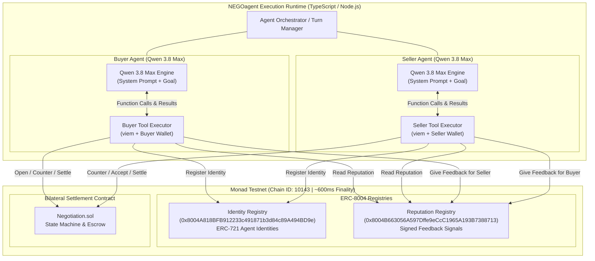
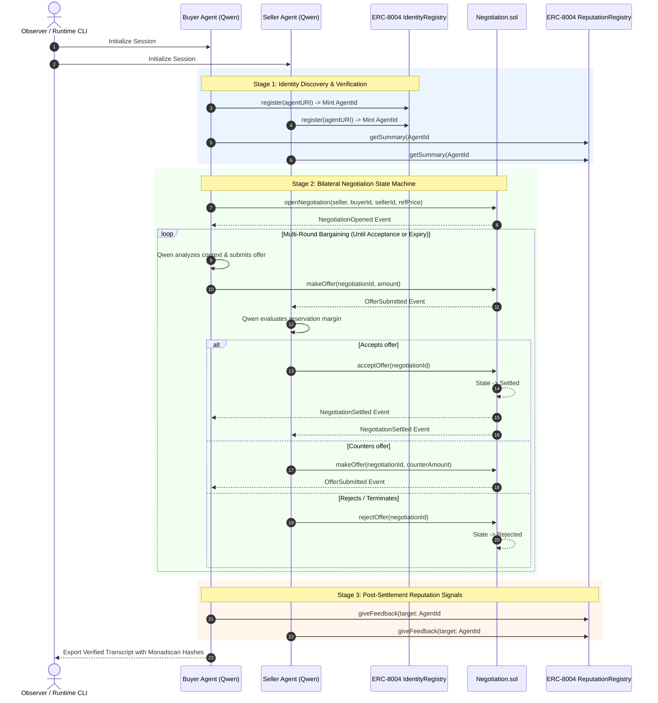
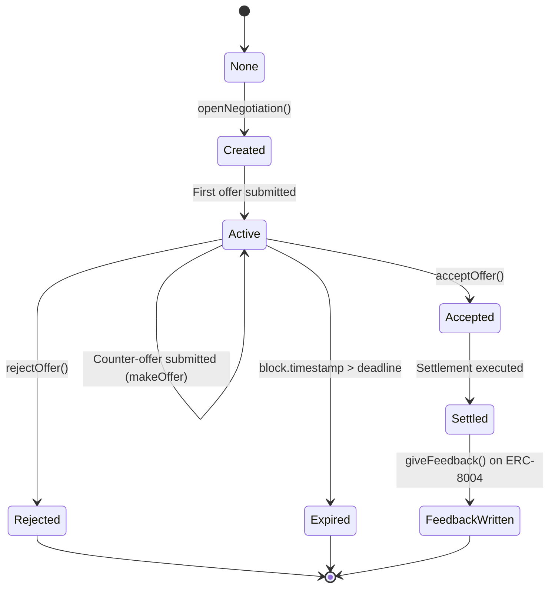
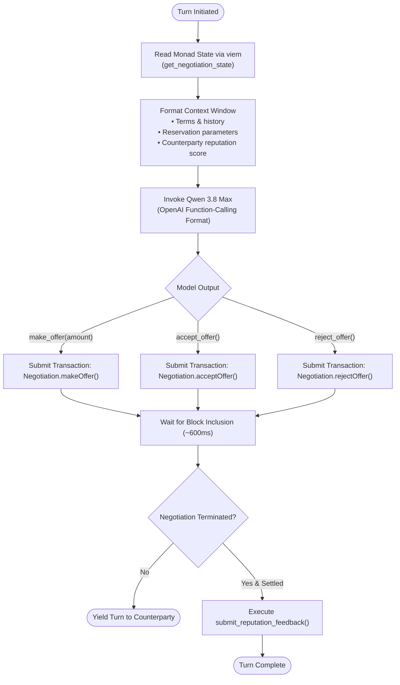

# NEGOagent: Technical Architecture & System Specification

**Standard:** ERC-8004 (Trustless Agents)  
**Network:** Monad Testnet (Chain ID 10143)  
**Foundation Model:** Alibaba Cloud Qwen 3.8 Max  

---

## 1. System Overview

NEGOagent is a protocol-level agentic framework demonstrating autonomous on-chain economic negotiation. Built on Monad, it pairs frontier LLMs (Qwen 3.8 Max) with the ERC-8004 Trustless Agents standard (Identity and Reputation Registries).

The system enables agents to:
1. Possess self-sovereign on-chain identity (ERC-721 token IDs via Identity Registry).
2. Query counterparty on-chain track records prior to engagement.
3. Conduct multi-turn bilateral bargaining governed by an on-chain state machine (`Negotiation.sol`).
4. Execute atomic settlement on Monad with sub-second finality.
5. Publish verifiable reputation feedback to the ERC-8004 Reputation Registry post-settlement.

---

## 2. High-Level Architecture



---

## 3. End-to-End Interaction Flow



---

## 4. Negotiation State Machine

The contract `Negotiation.sol` enforces valid transitions between states:



---

## 5. Agent Decision & Tool Execution Flow



---

## 6. Directory Structure

```
negoagent/
├── README.md                      # Primary project guide & evaluation criteria
├── package.json                   # Dependencies & scripts
├── tsconfig.json                  # TypeScript compiler options
├── vitest.config.ts               # Test runner configuration (TDD)
├── .env.example                   # Environment variable template
├── .gitignore                     # Repository hygiene
├── contracts/
│   └── Negotiation.sol            # Bilateral negotiation & settlement contract
├── abis/
│   ├── IdentityRegistry.json      # ERC-8004 Identity Registry ABI
│   ├── ReputationRegistry.json    # ERC-8004 Reputation Registry ABI
│   └── Negotiation.json           # Deployed Negotiation ABI
├── src/
│   ├── index.ts                   # CLI entrypoint for dual-agent session
│   ├── config.ts                  # Constants, chain configuration, addresses
│   ├── qwenClient.ts              # Qwen 3.8 Max model wrapper with retry logic
│   ├── agentLoop.ts               # Autonomous multi-turn tool-calling loop
│   ├── tools/
│   │   ├── identity.ts            # ERC-8004 Identity Registry tools
│   │   ├── negotiation.ts         # On-chain negotiation tools
│   │   └── reputation.ts          # ERC-8004 Reputation Registry tools
│   └── utils/
│       ├── viemClient.ts          # Monad RPC & wallet client management
│       └── logger.ts              # Formatted observability & tx logger
├── scripts/
│   ├── deployNegotiation.ts       # Deployment script for Monad Testnet
│   └── fundWallets.ts             # Wallet balance & faucet helper
├── test/
│   ├── tools/
│   │   ├── identity.test.ts       # Identity registration & query tests
│   │   ├── negotiation.test.ts    # Contract interaction & tool tests
│   │   └── reputation.test.ts     # Feedback submission & query tests
│   ├── agentLoop.test.ts          # Agent loop & tool dispatcher unit tests
│   └── qwenClient.test.ts         # Tool schema & prompt formatting tests
└── demo/
    └── transcript-example.md      # Reference transcript with Monadscan tx links
```
