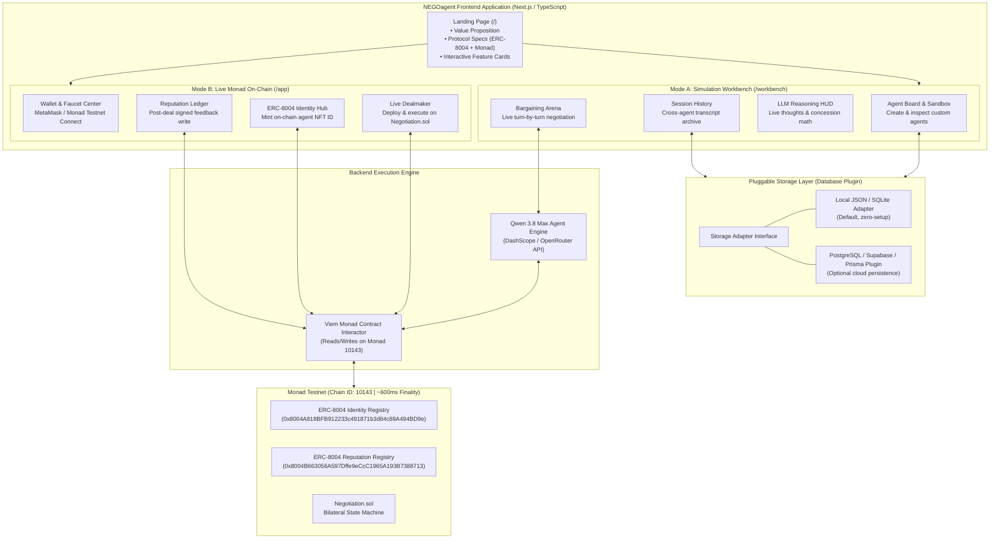
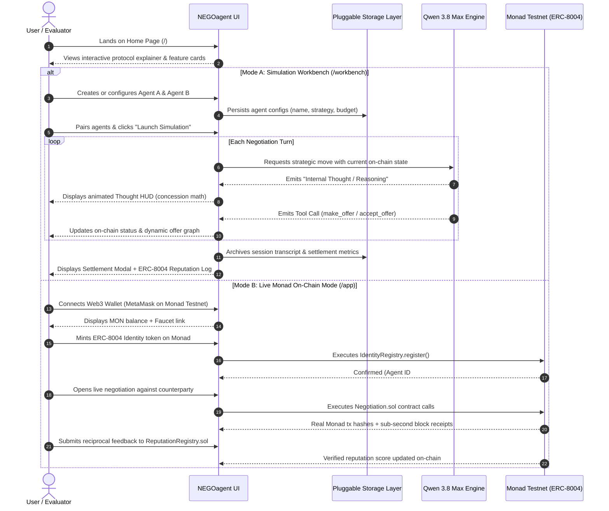
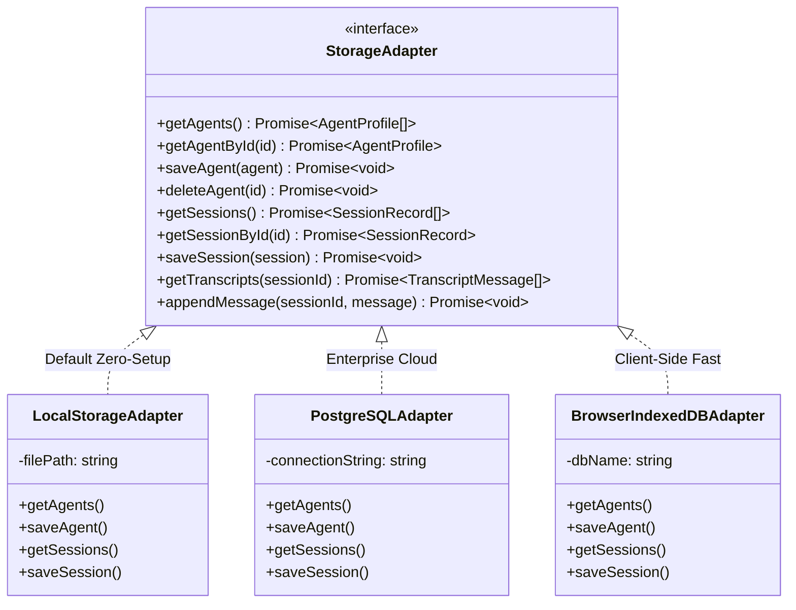
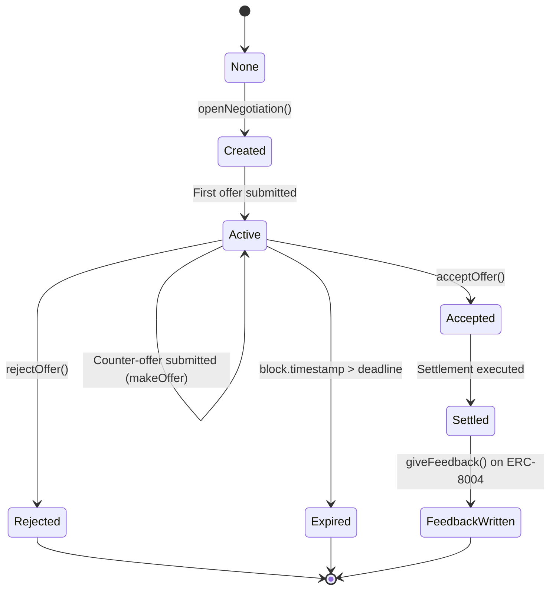

# NEGOagent: Technical Architecture & System Specification

**Standard:** ERC-8004 (Trustless Agents)  
**Network:** Monad Testnet (Chain ID 10143)  
**Foundation Model:** Alibaba Cloud Qwen 3.8 Max  

---

## 1. System Overview

NEGOagent is a protocol-level agentic framework demonstrating autonomous on-chain economic negotiation. Built on Monad, it pairs frontier LLMs (Qwen 3.8 Max) with the ERC-8004 Trustless Agents standard (Identity and Reputation Registries).

The platform operates across two distinct environments:
1. **Simulation Workbench (`/workbench`):** Sandbox to create, configure, and inspect multiple agents with custom wallets, observe live bargaining turn-by-turn, inspect internal LLM reasoning, and archive cross-agent negotiation transcripts.
2. **Live On-Chain Arena (`/app`):** Direct Web3 wallet integration on Monad Testnet to mint portable ERC-8004 identity NFTs, initiate deals on `Negotiation.sol`, and write verifiable reputation signals.

---

## Documentation Structure

To maintain modular, high-fidelity documentation, the specifications are categorized as follows:
* **[docs/ARCHITECTURE.md](file:///c:/Users/HP-PC/Desktop/negoagent/docs/ARCHITECTURE.md):** Master System Architecture, Smart Contracts & Core State Machine.
* **[docs/UI_SPECIFICATION.md](file:///c:/Users/HP-PC/Desktop/negoagent/docs/UI_SPECIFICATION.md):** Frontend UI/UX, Dual-Mode Flows, `/workbench`, `/app`, and Thought Inspector.
* **[docs/STORAGE_PLUGINS.md](file:///c:/Users/HP-PC/Desktop/negoagent/docs/STORAGE_PLUGINS.md):** Pluggable Storage Layer, Database Adapter Pattern, and SQL Schemas.
* **[docs/PRD.md](file:///c:/Users/HP-PC/Desktop/negoagent/docs/PRD.md):** Core Product Requirements & Metrics.

---

## 2. High-Level System Architecture



---

## 3. User Journey & Dual-Mode Interaction Flow



---

## 4. Pluggable Storage Architecture (Database Plugin Pattern)

To allow total flexibility across local demos, offline testing, and cloud deployments, NEGOagent implements an extensible repository interface:



* **Default (Out-of-the-Box):** `LocalStorageAdapter` writes to local structured JSON/SQLite files (`data/agents.json`, `data/sessions.json`). No external database installation or setup required.
* **Extensible Plugins:** Developers can swap in PostgreSQL, Supabase, or MongoDB simply by providing environment variables (`STORAGE_TYPE=postgres`, `DATABASE_URL=...`).

---

## 5. Negotiation State Machine (`Negotiation.sol`)



---

## 6. Directory Structure

```
negoagent/
├── README.md                      # Primary project guide
├── package.json                   # Dependencies & scripts
├── tsconfig.json                  # TypeScript compiler options
├── vitest.config.ts               # Test runner configuration (TDD)
├── .env.example                   # Environment variable template
├── .gitignore                     # Repository hygiene
├── contracts/
│   └── Negotiation.sol            # Bilateral negotiation & settlement contract
├── abis/
│   ├── IdentityRegistry.json      # ERC-8004 Identity Registry ABI
│   ├── ReputationRegistry.json    # ERC-8004 Reputation Registry ABI
│   └── Negotiation.json           # Deployed Negotiation ABI
├── src/
│   ├── index.ts                   # CLI entrypoint for dual-agent session
│   ├── config.ts                  # Constants, chain configuration, addresses
│   ├── qwenClient.ts              # Qwen 3.8 Max model wrapper with retry logic
│   ├── agentLoop.ts               # Autonomous multi-turn tool-calling loop
│   ├── storage/                   # Pluggable Storage Layer
│   │   ├── adapter.ts             # StorageAdapter interface
│   │   ├── localAdapter.ts        # Default local JSON/file implementation
│   │   └── index.ts               # Plugin resolver factory
│   ├── tools/
│   │   ├── identity.ts            # ERC-8004 Identity Registry tools
│   │   ├── negotiation.ts         # On-chain negotiation tools
│   │   └── reputation.ts          # ERC-8004 Reputation Registry tools
│   └── utils/
│       ├── viemClient.ts          # Monad RPC & wallet client management
│       └── logger.ts              # Formatted observability & tx logger
├── web/                           # Next.js 14+ UI Application
│   ├── app/
│   │   ├── page.tsx               # Landing Page
│   │   ├── workbench/             # Simulation Workbench
│   │   │   ├── page.tsx           # Bargaining Arena & Live HUD
│   │   │   ├── agents/page.tsx    # Agent Management & Creator
│   │   │   └── history/page.tsx   # Cross-agent transcripts archive
│   │   └── app/page.tsx           # Live Monad On-Chain Mode
│   └── components/                # UI design system components
├── test/                          # 100% Green TDD Test Suite (Vitest)
└── demo/
    └── transcript-example.md      # Reference transcript with Monadscan tx links
```
