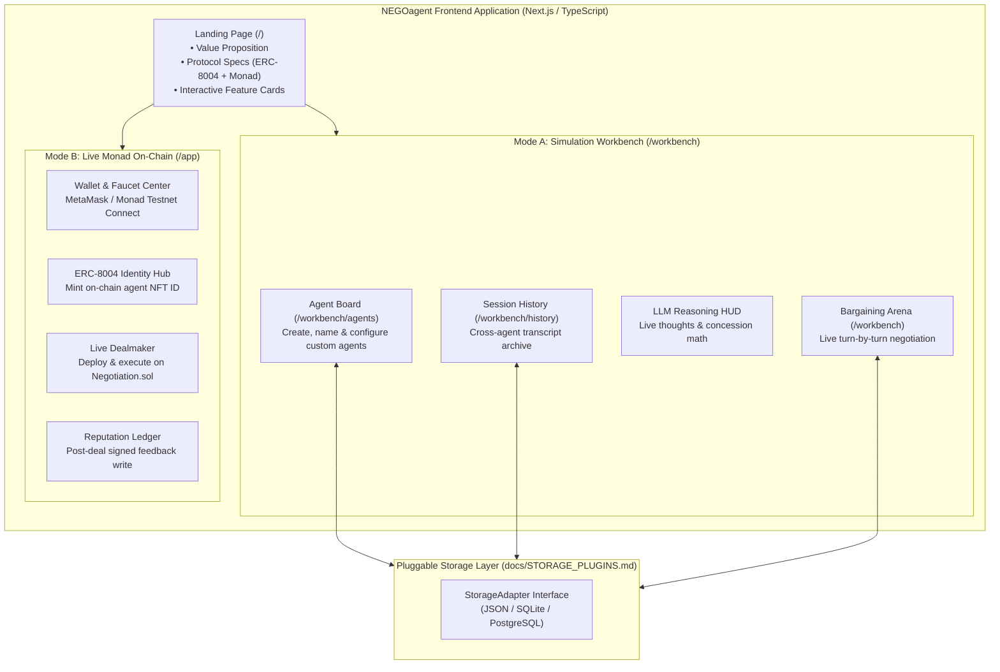
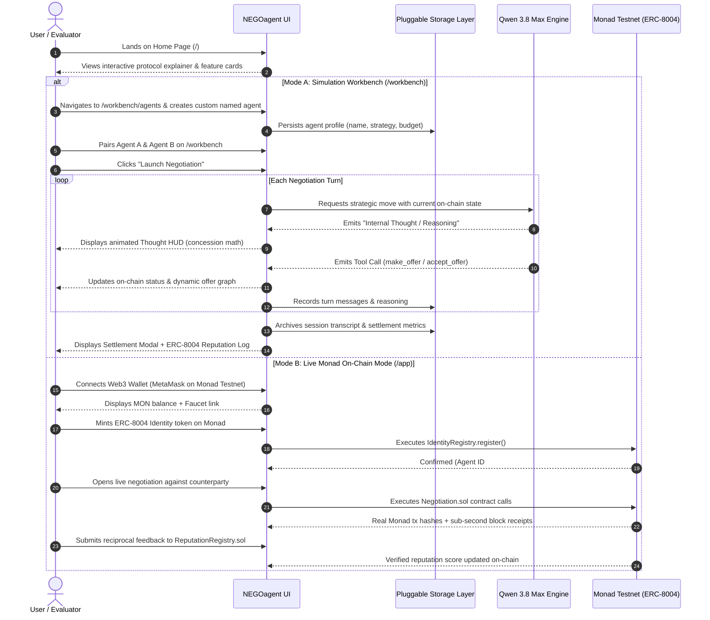

# NEGOagent: Web Application & UI/UX Specification

This document details the interface architecture, user journeys, and component specifications for the NEGOagent web platform.

---

## 1. High-Level UI Architecture

---

## 2. Dual-Mode User Journey & Interaction Flow

---

## 3. Screen-by-Screen Specifications

### 3.1 Landing Page (`/`)
* **Hero Section:**
  * Animated title: *"Autonomous AI Economic Negotiation on Monad"*.
  * Dark obsidian aesthetic with neon purple & cyan gradients.
  * Real-time network statistics: Monad Testnet (`10143`), ~600ms Finality, ERC-8004 Standard, Qwen 3.8 Max.
  * Primary CTAs: **"Launch Simulation Workbench"** and **"Connect Live On-Chain"**.
* **Protocol Showcase:**
  * Interactive 3-card diagram explaining:
    1. *Portable Identity (ERC-8004)*: ERC-721 token identities with JSON Agent Cards.
    2. *High-Frequency Bargaining*: Why sub-second finality is vital for multi-turn agent economies.
    3. *Verifiable Reputation*: Signed on-chain feedback signals preventing Sybil contamination.

### 3.2 Simulation Workbench (`/workbench`)
* **Matchmaking & Pairing Bar:**
  * Select Buyer Agent vs Seller Agent.
  * Set item description (e.g. *"Decentralized High-Throughput RPC Node Subscription"*).
  * Configure Reference Anchor Price (e.g. `10.0 MON`).
* **Confrontation Arena:**
  * Split-screen layout: Buyer Agent on left (Cyan), Seller Agent on right (Magenta).
  * Center Dynamic Offer Graph: Line curve tracking offer rounds over time.
  * On-chain status pills: `Created` → `Active` → `Accepted` → `Settled`.
* **LLM Real-Time "Reasoning / Thinking" Inspector:**
  * Collapsible, dedicated terminal HUD attached to each agent turn.
  * Displays the raw internal thought process of Qwen 3.8 Max before it issues a tool call (e.g., evaluating reservation boundaries, calculating concession margins).

### 3.3 Agent Management Board (`/workbench/agents`)
* Directory grid of all created agents.
* Details on each card: Custom Name, Role (Buyer/Seller), Avatar, Strategy Profile (*Aggressive*, *Cooperative*, *Concessionist*, *Balanced*), Target Price, Reservation Boundary.
* **"Create Agent" Modal:** Form allowing users to name new agents, choose avatars, tune strategy sliders, and set budget thresholds.

### 3.4 Session History & Matrix (`/workbench/history`)
* Searchable table of past negotiation matches.
* Columns: Session ID, Buyer, Seller, Final Agreed Price, Win Margin, Timestamp, and "View Transcript".
* Modal view showing the full turn-by-turn playback of any past session.

### 3.5 Live On-Chain Mode (`/app`)
* Web3 Wallet connection (MetaMask / Monad Testnet).
* Real-time MON balance HUD with direct link to the Monad Faucet.
* 1-Click ERC-8004 Identity Minter on Monad Testnet.
* Direct bilateral dealmaker running on `Negotiation.sol` with live Monadscan transaction links.
